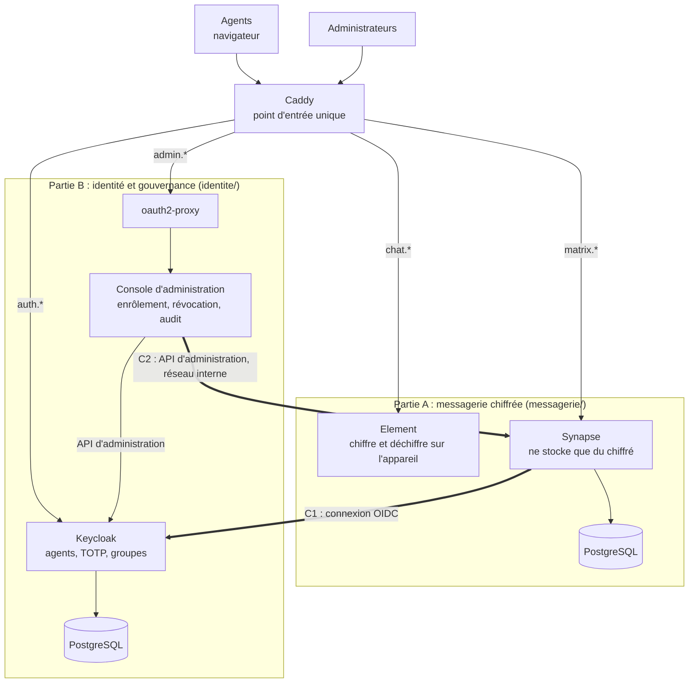

# Messagerie souveraine de l'administration

Messagerie instantanée chiffrée de bout en bout pour les agents publics du Burkina Faso (messages,
groupes, fichiers, messages vocaux), hébergée sur l'infrastructure de l'État et installée en une
seule commande.

> Sprint technique pré-hackathon 2026 (Hackathon 226) · Challenge du MTDPCE, Direction générale de
> la transformation digitale.

## Concept

- **Le serveur ne lit rien** : messages et fichiers sont chiffrés sur l'appareil de l'agent (protocole
  Matrix, Olm/Megolm) ; le serveur ne stocke que du contenu illisible.
- **Seuls les agents enrôlés entrent**, avec un mot de passe et un code à usage unique (TOTP) obligatoire.
- **Un administrateur retire un agent en un clic** (départ, perte du téléphone) : il perd l'accès sur
  tous ses appareils en une à deux secondes, et l'opération est tracée.
- **Aucun service extérieur** : tout tourne sur le serveur de l'État.

## Architecture



Les deux parties ne se touchent que par deux contrats : **C1**, Synapse délègue la connexion des
agents à Keycloak et n'accepte que le groupe `agents` ; **C2**, la console désactive les comptes dans
Synapse par le réseau interne. Le contrat **C3** fixe les noms d'hôtes et le format des identifiants
(`@prenom.nom:messagerie.gov.bf`). Le détail est dans [architecture-deux-parties.md](architecture-deux-parties.md).

| Exigence du socle | Mise en œuvre |
|---|---|
| Chiffrement de bout en bout | Matrix (Olm/Megolm, bibliothèque vodozemac intégrée à Element), imposé à tous les salons ; fichiers chiffrés sur l'appareil. Aucune cryptographie écrite par l'équipe. |
| Hébergement souverain | `docker compose up -d` ; aucun serveur de clés tiers, pas de statistiques, pas d'aperçu de liens, fédération fermée. |
| Identité vérifiée | Inscription désactivée ; comptes créés par un administrateur ; groupe `agents` exigé ; TOTP obligatoire pour tous ; rôles par groupes. |
| Révocation immédiate | Console : identité désactivée, sessions fermées, compte de messagerie désactivé (jetons, appareils, clés, salons), vérification, rapport et journal d'audit. |
| Minimisation des métadonnées | Présence désactivée, annuaire fermé, notifications sans contenu. Ce que le serveur voit malgré tout est listé dans les limites. |

## Installation

Prérequis : Docker et Docker Compose v2, ports 80 et 443 libres, environ 2 Go de mémoire.

```bash
cp .env.example .env    # valeurs fictives de démonstration
docker compose up -d
```

| Service | Adresse |
|---|---|
| Messagerie (Element) | http://chat.localhost |
| Console d'administration | http://admin.localhost |
| Identité (Keycloak) | http://auth.localhost/admin |

Comptes fictifs, codes TOTP (avec QR codes) et scénarios de démonstration : [DEMO.md](DEMO.md).

**En production** : remplacer toutes les valeurs du `.env` ; `DOMAIN` (ex. `messagerie.gov.bf`),
`PUBLIC_SCHEME=https`, `OAUTH2_PROXY_COOKIE_SECURE=true` ; adapter l'adresse du serveur dans
`messagerie/element/config.json`.

## Organisation du dépôt

| Dossier | Contenu | Documentation |
|---|---|---|
| `messagerie/` | Partie A : Synapse, Element, routes `chat.*` et `matrix.*` | [messagerie/README.md](messagerie/README.md) |
| `identite/` | Partie B : Keycloak, oauth2-proxy, console d'administration, routes `auth.*` et `admin.*` | [identite/LISEZMOI.md](identite/LISEZMOI.md) |
| racine | Assemblage (`docker-compose.yml`, `Caddyfile`, `.env.example`), démonstration, licence | |

## Tests

```bash
docker compose exec console-admin python -m pytest -q
```

Tests unitaires de la console (vérification des jetons, révocation, enrôlement, garde-fous) et tests
d'intégration contre le vrai Synapse (révocation complète, inscription libre refusée).

## Technologies et licences

| Composant | Rôle | Licence |
|---|---|---|
| [Synapse](https://github.com/element-hq/synapse) | Serveur Matrix | AGPL-3.0 |
| [Element Web](https://github.com/element-hq/element-web) | Application des agents | AGPL-3.0 ou GPL-3.0 |
| [vodozemac](https://github.com/matrix-org/vodozemac) | Chiffrement Olm et Megolm, intégré à Element | Apache-2.0 |
| [Keycloak](https://github.com/keycloak/keycloak) | Identité, second facteur, groupes | Apache-2.0 |
| [oauth2-proxy](https://github.com/oauth2-proxy/oauth2-proxy) | Protection de la console | MIT |
| [Caddy](https://github.com/caddyserver/caddy) | Point d'entrée | Apache-2.0 |
| [PostgreSQL](https://www.postgresql.org) | Bases de données | Licence PostgreSQL |
| [FastAPI](https://github.com/fastapi/fastapi), [Pydantic](https://github.com/pydantic/pydantic) | Console d'administration | MIT |
| [Uvicorn](https://github.com/encode/uvicorn), [HTTPX](https://github.com/encode/httpx) | Serveur web et client HTTP de la console | BSD-3-Clause |
| [PyJWT](https://github.com/jpadilla/pyjwt) | Vérification de la signature des jetons | MIT |
| [Docker Compose](https://github.com/docker/compose) | Déploiement | Apache-2.0 |

## Limites connues

- **Métadonnées** : le serveur voit qui est membre de quel salon, qui envoie un message et quand, la
  taille approximative des contenus, les adresses IP, les noms et sujets des salons. Consigne aux
  agents : aucune information sensible dans le nom ou le sujet d'un salon.
- **Appareil hors ligne** : un appareil éteint au moment de la révocation conserve ce qu'il avait
  déjà déchiffré ; il ne peut ni recevoir ni déchiffrer les nouveaux messages.
- **Captures d'écran** : impossibles à bloquer dans un navigateur ; une photo de l'écran reste possible.
- **Appareil compromis** : aucun chiffrement ne protège contre un logiciel espion sur l'appareil d'un agent.
- **Prototype à un seul serveur** ; la cible nationale est un serveur par ministère, reliés par une fédération fermée.
- **Keycloak** est le composant le plus sensible : sa compromission équivaut à celle des identités.

## Licence

Ce projet est distribué sous licence [AGPL-3.0](LICENSE).
