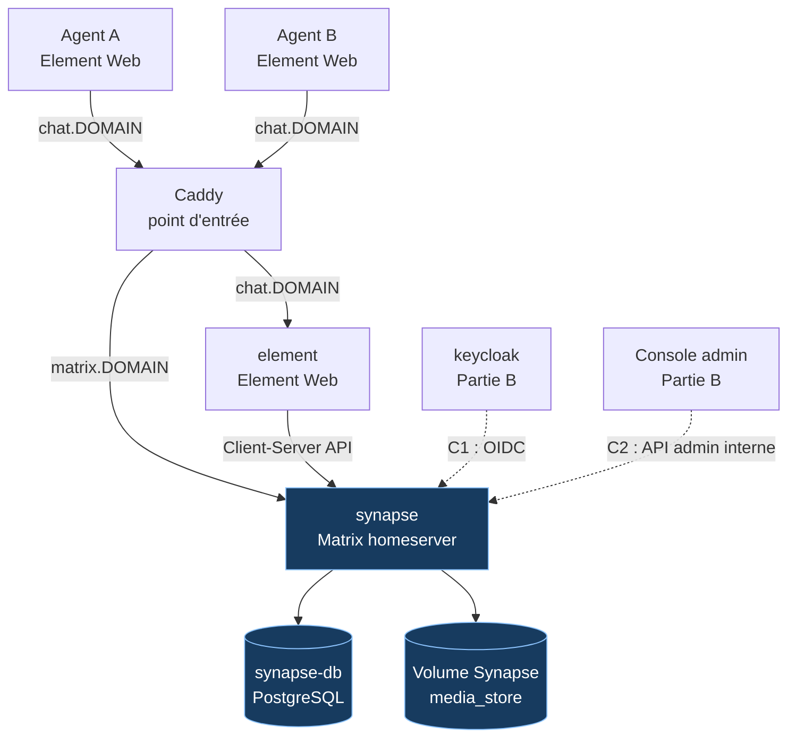

# Partie A — Messagerie chiffrée

Ce dossier contient la **partie A** de la messagerie souveraine de
l'administration. Son rôle est de fournir aux agents une messagerie Matrix
auto-hébergée, avec messages, fichiers et contenus audio chiffrés de bout en
bout.

La partie A ne gère pas l'enrôlement administratif ni la révocation des agents.
Ces fonctions appartiennent à la partie B, qui utilise les contrats décrits dans
ce document.

## 1. Objectifs

La partie A doit garantir les propriétés suivantes :

- les messages sont chiffrés sur l'appareil de l'agent avant leur envoi ;
- les fichiers et contenus audio sont chiffrés par Element avant leur dépôt ;
- Synapse relaie et stocke des événements chiffrés, mais ne possède pas les
  clés privées de déchiffrement ;
- aucun serveur tiers n'est requis pour fonctionner ;
- l'inscription publique est désactivée ;
- tous les salons privés sont chiffrés par défaut ;
- l'API d'administration Synapse n'est jamais exposée publiquement ;
- l'ensemble démarre avec Docker Compose ;
- la connexion peut être autonome avec mot de passe pendant le développement,
  puis être déléguée à Keycloak lors de l'intégration.

## 2. Architecture



### Services

| Service | Image | Rôle | Exposition |
|---|---|---|---|
| `caddy` | `caddy:2.8` | Routage HTTP/HTTPS et blocage de l'API admin | ports 80/443 |
| `element` | `vectorim/element-web:v1.11.95` | Interface utilisée par les agents | réseau Docker uniquement |
| `synapse` | `matrixdotorg/synapse:v1.164.1` | Serveur Matrix | réseau Docker uniquement |
| `synapse-db` | `postgres:16-alpine` | Base de données Synapse | réseau Docker uniquement |

Les services ne publient aucun port directement à l'exception de Caddy. Les
agents passent par `chat.<DOMAIN>` et `matrix.<DOMAIN>`.

## 3. Arborescence

```text
.
├── docker-compose.yml                 # Assemblage racine
├── Caddyfile                          # Import des sites Caddy
├── .env.example                       # Variables de démonstration
└── messagerie/
    ├── compose.yml                    # Services de la partie A
    ├── caddy.caddy                    # Routes chat.* et matrix.*
    ├── element/
    │   └── config.json                # Configuration souveraine d'Element
    ├── scripts/
    │   ├── create-demo-users.sh       # Création des comptes autonomes
    │   └── verify-part-a.sh            # Vérifications HTTP et Docker
    └── synapse/
        ├── entrypoint.sh              # Génération puis lancement Synapse
        └── homeserver.yaml.template   # Configuration paramétrable
```

## 4. Démarrage autonome

Le mode autonome sert uniquement au développement et aux tests de la partie A.
Il permet de créer des utilisateurs Matrix avec un mot de passe local, sans
attendre Keycloak.

### Pré-requis

- Docker Engine ;
- Docker Compose v2 ;
- ports 80 et 443 disponibles ;
- un navigateur compatible avec Element ;
- sous Linux, `*.localhost` doit résoudre vers la machine locale, ce qui est
  normalement le comportement standard des navigateurs.

### Installation

Depuis la racine du dépôt :

```bash
cp .env.example .env
chmod +x messagerie/synapse/entrypoint.sh
chmod +x messagerie/scripts/*.sh
docker compose --env-file .env config -q
docker compose --env-file .env up -d caddy synapse-db synapse element
```

Vérifier l'état :

```bash
docker compose --env-file .env ps
```

Les conteneurs `caddy`, `element`, `synapse` et `synapse-db` doivent être
actifs. Synapse et PostgreSQL doivent être `healthy`.

### Comptes de démonstration

En mode autonome, `.env` doit contenir :

```bash
SYNAPSE_PASSWORD_LOGIN=true
```

Créer les deux comptes de test :

```bash
messagerie/scripts/create-demo-users.sh
```

Comptes créés :

| Identifiant | Mot de passe | Usage |
|---|---|---|
| `awa.test` | `motdepasse-test` | Agent principal |
| `issa.test` | `motdepasse-test` | Second agent |

Ces comptes sont exclusivement fictifs. Ils ne doivent jamais être utilisés en
production.

### Accès

- Element : [http://chat.localhost](http://chat.localhost)
- API Matrix : [http://matrix.localhost/_matrix/client/versions](http://matrix.localhost/_matrix/client/versions)

Dans Element :

1. ouvrir `chat.localhost` ;
2. choisir **Sign in** ;
3. saisir `awa.test` et son mot de passe ;
4. créer un salon privé ;
5. vérifier que le chiffrement est activé et obligatoire ;
6. inviter `issa.test` ;
7. envoyer un texte, un fichier et un contenu audio.

## 5. Vérifications automatisées

Exécuter :

```bash
messagerie/scripts/verify-part-a.sh
```

Ce script vérifie :

- la validité de la configuration Compose ;
- l'exécution des quatre services ;
- la disponibilité d'Element en HTTP 200 ;
- la disponibilité de l'API Matrix en HTTP 200 ;
- le refus de l'API d'administration publique en HTTP 403.

Tester directement une connexion autonome :

```bash
curl -X POST http://matrix.localhost/_matrix/client/v3/login \
  -H 'Content-Type: application/json' \
  -d '{
    "type": "m.login.password",
    "identifier": {"type": "m.id.user", "user": "awa.test"},
    "password": "motdepasse-test"
  }'
```

## 6. Preuve du chiffrement

La preuve doit être faite après l'envoi d'un texte, d'un fichier et d'un audio
dans un salon créé avec Element.

Inspecter les types d'événements :

```bash
docker compose --env-file .env exec synapse-db psql \
  -U synapse -d synapse \
  -c 'SELECT type, count(*) FROM events GROUP BY type ORDER BY count(*) DESC;'
```

Les contenus doivent apparaître sous `m.room.encrypted`. Les événements
`m.room.create`, `m.room.member`, `m.room.name` et `m.room.encryption` sont des
événements de structure et peuvent rester lisibles. En revanche, le contenu
des messages ne doit pas apparaître comme un événement `m.room.message`.

Inspecter un salon précis :

```bash
docker compose --env-file .env exec synapse-db psql \
  -U synapse -d synapse \
  -c "SELECT type, left(j.json::text, 300) \
      FROM events e JOIN event_json j USING (event_id) \
      WHERE e.room_id = '<ROOM_ID>' \
      ORDER BY e.stream_ordering DESC;"
```

Inspecter le stockage média :

```bash
docker compose --env-file .env exec synapse \
  sh -c 'find /data/media_store -type f -printf "%f %s bytes\n"'
```

Les noms de fichiers du `media_store` sont opaques. Le serveur ne doit pas
contenir le nom original ni le contenu audio ou fichier en clair.

## 7. Sécurité et minimisation

La configuration de [homeserver.yaml.template](./synapse/homeserver.yaml.template)
met en œuvre les protections suivantes :

- `encryption_enabled_by_default_for_room_type: all` ;
- `enable_registration: false` ;
- `trusted_key_servers: []` ;
- `report_stats: false` ;
- `send_federation: false` pour le prototype ;
- présence désactivée ;
- annuaire utilisateur désactivé ;
- notifications sans contenu ;
- rétention par défaut limitée à 30 jours ;
- connexion par mot de passe activable uniquement en autonome ;
- inscription libre refusée ;
- génération locale de la clé de signature Synapse.

Le serveur voit malgré tout certaines métadonnées Matrix : membres d'un salon,
identifiants, horaires, tailles approximatives, adresses IP temporaires et
noms de salons. Il ne voit pas le contenu chiffré ni les clés privées des
appareils.

Limites à présenter honnêtement :

- un appareil hors ligne peut conserver les messages déjà déchiffrés ;
- une capture d'écran reste toujours possible ;
- un appareil compromis peut révéler les messages ;
- la présence d'un serveur unique limite la résilience du prototype ;
- les noms et sujets de salons ne sont pas protégés par le chiffrement de
  contenu et ne doivent pas contenir d'informations sensibles.

## 8. Contrat C1 — Connexion OIDC Keycloak

La partie B fournit Keycloak. La partie A le consomme via Synapse.

| Élément | Valeur attendue |
|---|---|
| Realm | `administration` |
| Client | `synapse` |
| Secret | variable commune `OIDC_SYNAPSE_SECRET` |
| Émetteur public | `${PUBLIC_SCHEME}://auth.${DOMAIN}/realms/administration` |
| Autorisation navigateur | `https://auth.<DOMAIN>/.../auth` |
| Points internes Synapse | `http://keycloak:8080/realms/administration/protocol/openid-connect/...` |
| Groupe requis | `agents` |
| Identifiant | `preferred_username`, en minuscules |
| Nom affiché | attribut OIDC `name` |
| Callback | `${PUBLIC_SCHEME}://matrix.${DOMAIN}/_synapse/client/oidc/callback` |

Le fournisseur OIDC est déjà présent dans le template Synapse. La partie B doit
donc créer un client Keycloak nommé exactement `synapse`, avec le secret fourni
par `.env`, les URI de redirection correspondantes et un mapper `groups` dans
l'ID token.

Le groupe doit être transmis sous la forme :

```json
["agents"]
```

et non sous la forme `/agents`. Dans Keycloak, désactiver l'option
**Full group path** du mapper de groupes.

Après intégration :

```bash
SYNAPSE_PASSWORD_LOGIN=false
```

Le bouton de connexion Keycloak doit apparaître dans Element et un utilisateur
hors du groupe `agents` doit être refusé par Synapse.

## 9. Contrat C2 — API d'administration Synapse

La console de la partie B utilise Synapse uniquement sur le réseau Docker :

```text
http://synapse:8008
```

Elle ne doit pas utiliser `matrix.<DOMAIN>` pour ses appels internes.

### Secret partagé

La console obtient son jeton de service avec :

```bash
SYNAPSE_REGISTRATION_SHARED_SECRET
```

Cette variable est commune aux deux parties. Elle permet l'enregistrement
initial du compte de service administrateur Synapse. Elle ne doit pas être
exposée dans le navigateur.

### Endpoints consommés par la partie B

| Méthode | Chemin | Utilisation |
|---|---|---|
| `GET` / `POST` | `/_synapse/admin/v1/register` | Création initiale du compte de service |
| `GET` | `/_synapse/admin/v1/users/{mxid}/joined_rooms` | État des salons avant/après révocation |
| `POST` | `/_synapse/admin/v1/deactivate/{mxid}` | Désactivation d'un agent |
| `GET` | `/_synapse/admin/v2/users/{mxid}/devices` | Vérification de la suppression des appareils |

La révocation doit d'abord désactiver l'utilisateur dans Keycloak, puis dans
Synapse. La partie B doit vérifier que les jetons et appareils de l'utilisateur
ne sont plus utilisables.

### Protection publique

Depuis l'extérieur, les chemins suivants doivent toujours répondre `403` :

```text
http://matrix.<DOMAIN>/_synapse/admin/*
```

Test :

```bash
curl -i \
  -H 'Host: matrix.localhost' \
  http://127.0.0.1/_synapse/admin/v1/users
```

L'accès public à l'API d'administration est bloqué dans
[caddy.caddy](./caddy.caddy), tandis que l'accès interne Docker reste possible.

## 10. Contrat C3 — Routage et identifiants

| Adresse publique | Service interne | Usage |
|---|---|---|
| `chat.<DOMAIN>` | `element:80` | Interface agent |
| `matrix.<DOMAIN>` | `synapse:8008` | API Matrix |
| `matrix.<DOMAIN>/_synapse/admin/*` | aucun accès public | API admin bloquée |
| `auth.<DOMAIN>` | `keycloak:8080` | Partie B |
| `admin.<DOMAIN>` | `oauth2-proxy:4180` | Partie B |

Conventions partagées :

```text
SERVER_NAME=messagerie.gov.bf
@<preferred_username>:messagerie.gov.bf
```

Exemple :

```text
@awa.demo:messagerie.gov.bf
```

Les noms de services Docker à ne pas modifier sont :

```text
synapse
synapse-db
element
```

## 11. Intégration avec la partie B

La partie B doit ajouter ses fichiers sans modifier les fichiers internes de
`messagerie/`, sauf accord explicite. L'assemblage attendu est :

```text
identite/
├── compose.yml
├── caddy.caddy
├── keycloak/import/realm-administration.json
└── console-admin/
```

Le Compose racine devra ensuite inclure :

```yaml
include:
  - path: messagerie/compose.yml
  - path: identite/compose.yml
```

Le Caddyfile racine devra monter les deux fichiers de sites :

```yaml
volumes:
  - ./messagerie/caddy.caddy:/etc/caddy/sites/messagerie.caddy:ro
  - ./identite/caddy.caddy:/etc/caddy/sites/identite.caddy:ro
```

Ordre conseillé d'intégration :

1. démarrer la partie A seule avec `SYNAPSE_PASSWORD_LOGIN=true` ;
2. démarrer Keycloak et importer le realm `administration` ;
3. vérifier que `awa.demo` possède le groupe `agents` ;
4. remplacer `SYNAPSE_PASSWORD_LOGIN=false` ;
5. redémarrer Synapse ;
6. tester la connexion OIDC dans Element ;
7. tester le refus de `horsgroupe.demo` ;
8. tester la console et la révocation C2 ;
9. vérifier que l'API publique Synapse reste en 403 ;
10. exécuter `docker compose config -q` depuis un clone propre.

## 12. Dépannage

### Synapse redémarre avec une erreur de collation PostgreSQL

Le service PostgreSQL est initialisé avec `--locale=C --encoding=UTF8`.
Si un ancien volume a été créé avec une autre locale, supprimer uniquement le
volume de développement puis recréer les services :

```bash
docker compose --env-file .env down
docker volume rm messagerie-souveraine_synapse_db
docker compose --env-file .env up -d caddy synapse-db synapse element
```

Ne jamais supprimer un volume de production sans sauvegarde et validation.

### Element est unhealthy

Vérifier :

```bash
docker compose --env-file .env logs element
docker compose --env-file .env exec element \
  wget -q -O /dev/null http://127.0.0.1/
```

Le healthcheck utilise volontairement la syntaxe BusyBox compatible avec
l'image Element.

### Caddy ne démarre pas

Valider la configuration :

```bash
docker compose --env-file .env config -q
docker compose --env-file .env run --rm --no-deps caddy \
  caddy validate --config /etc/caddy/Caddyfile --adapter caddyfile
```

Vérifier que `DOMAIN` et `PUBLIC_SCHEME` sont définis.

### OIDC échoue

Vérifier les quatre valeurs suivantes :

- issuer public identique entre Keycloak et Synapse ;
- secret `OIDC_SYNAPSE_SECRET` identique ;
- callback exactement égal à
  `.../_synapse/client/oidc/callback` ;
- claim `groups` contenant `agents` sans préfixe `/`.

## 13. Critères d'acceptation de la partie A

- [x] `docker compose config -q` réussit ;
- [x] Synapse démarre avec PostgreSQL ;
- [x] Element est accessible ;
- [x] deux comptes autonomes peuvent se connecter ;
- [x] un salon privé est chiffré par défaut ;
- [x] texte, fichier et média audio sont envoyés depuis Element ;
- [x] les contenus apparaissent côté serveur sous `m.room.encrypted` ;
- [x] les médias sont stockés sous des noms opaques ;
- [x] l'API admin publique répond 403 ;
- [x] les variables C1, C2 et C3 sont documentées ;
- [ ] connexion complète avec Keycloak et TOTP ;
- [ ] test complet de révocation avec la console de la partie B.

## 14. Commandes utiles

```bash
# État des services
docker compose --env-file .env ps

# Logs Synapse
docker compose --env-file .env logs -f synapse

# Logs Caddy
docker compose --env-file .env logs -f caddy

# Arrêt sans supprimer les volumes
docker compose --env-file .env down

# Vérification de la configuration
docker compose --env-file .env config -q

# Vérification de la partie A
messagerie/scripts/verify-part-a.sh
```

La partie A est prête à être intégrée lorsque la partie B respecte strictement
les contrats C1, C2 et C3 ci-dessus.
