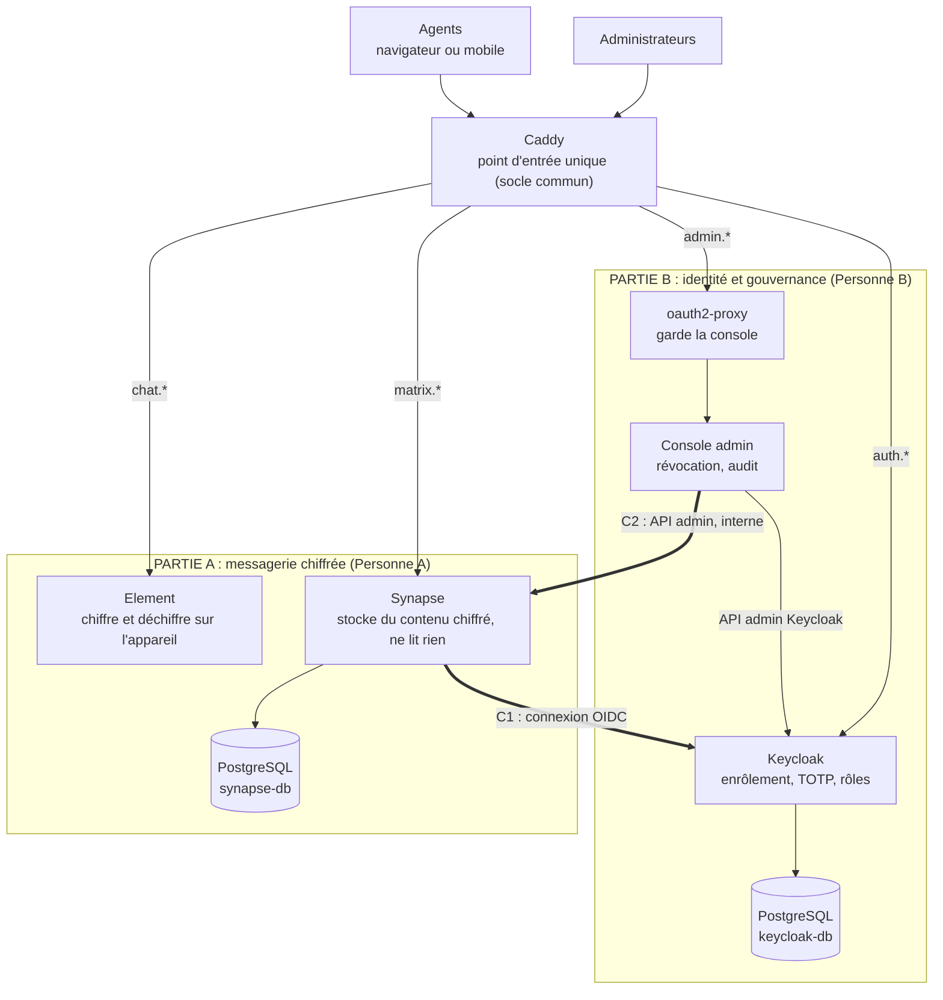

# Architecture en deux parties : messagerie souveraine de l'administration

**Sprint technique pré-hackathon 2026 (Hackathon 226) : découpage pour deux personnes, intégration par contrats**

> Ce document découpe le projet en **deux grandes parties indépendantes**, chacune réalisable par une personne, reliées par **trois contrats d'interface** explicites. Chaque partie vit dans son propre dossier : les deux personnes ne modifient jamais les mêmes fichiers, et l'assemblage se fait par une seule commande, `docker compose up -d`.
>
> Il complète le dossier projet (`messagerie-souveraine-dossier-projet.md`), qui reste la référence pour le sujet, la sécurité et la préparation de l'entretien.
>
> Dernière mise à jour : samedi 31 octobre 2026. Dépôt : **dimanche 1er novembre 2026**.

---

## Sommaire

1. [Le principe : deux plans, trois contrats](#1-le-principe--deux-plans-trois-contrats)
2. [Vue d'ensemble](#2-vue-densemble)
3. [Partie A : messagerie chiffrée](#3-partie-a--messagerie-chiffrée)
4. [Partie B : identité et gouvernance](#4-partie-b--identité-et-gouvernance)
5. [Le socle commun](#5-le-socle-commun)
6. [Les contrats d'interface](#6-les-contrats-dinterface)
7. [Arborescence et propriété des fichiers](#7-arborescence-et-propriété-des-fichiers)
8. [Intégration : trois rendez-vous](#8-intégration--trois-rendez-vous)
9. [Organisation Git](#9-organisation-git)
10. [Planning jusqu'au dépôt](#10-planning-jusquau-dépôt)
11. [Répartition du dossier de candidature](#11-répartition-du-dossier-de-candidature)
12. [Plan de repli si le temps manque](#12-plan-de-repli-si-le-temps-manque)
13. [Ce qui a été vérifié](#13-ce-qui-a-été-vérifié)

---

## 1. Le principe : deux plans, trois contrats

Le système se coupe naturellement en deux :

| | **Partie A : messagerie chiffrée** | **Partie B : identité et gouvernance** |
|---|---|---|
| **Question à laquelle elle répond** | Comment les agents échangent-ils sans que le serveur puisse lire ? | Qui a le droit d'entrer, et comment lui retirer ce droit ? |
| **Utilisateur principal** | L'agent | L'administrateur |
| **Composants** | Synapse, PostgreSQL (synapse-db), Element | Keycloak, PostgreSQL (keycloak-db), oauth2-proxy, console admin |
| **Exigences du socle couvertes** | Chiffrement de bout en bout, hébergement souverain, minimisation des métadonnées | Identité vérifiée (enrôlement, 2FA, rôles), révocation immédiate |
| **Épreuves en direct portées** | Le serveur ne lit rien, Innovation | Révocation, Intrus |
| **Dossier du dépôt** | `messagerie/` | `identite/` |

Les deux parties ne se parlent qu'à travers **trois contrats** :

| Contrat | Fournisseur | Consommateur | En une phrase |
|---|---|---|---|
| **C1 : connexion OIDC** | B | A | Synapse délègue la connexion des agents à Keycloak |
| **C2 : API d'administration Synapse** | A | B | La console désactive les comptes dans Synapse, en interne uniquement |
| **C3 : routage et identifiants** | Commun | Les deux | Noms d'hôtes, noms des services, format des identifiants, groupes |

Tout ce qui fait le lien (secrets, domaine) est centralisé dans **un seul fichier `.env`** à la racine.

### Ce qui est meilleur que l'architecture précédente

| Avant | Maintenant |
|---|---|
| Un seul `docker-compose.yml` modifié par tout le monde | Un fichier par partie, assemblés par `include` : **zéro conflit Git** |
| Un seul Caddyfile partagé | Chaque partie déclare ses propres sites (`caddy.caddy`), importés automatiquement |
| Intégration « au feeling » | Trois contrats écrits, chacun avec un **test d'acceptation** |
| Synapse découvrait Keycloak par son URL publique (piège classique sous Docker) | Le navigateur utilise l'URL publique, les serveurs se parlent en interne : fonctionne en local comme en production |
| Jeton d'administration Synapse à copier à la main | La console l'obtient **seule** au démarrage grâce au secret partagé : l'installation reste en une commande |
| API d'administration de Synapse exposée par défaut | Bloquée publiquement par Caddy (403), accessible seulement sur le réseau interne |
| Synapse interrogeait matrix.org pour les clés de serveurs | `trusted_key_servers: []` : plus aucun service tiers |
| Chaque personne dépendait de l'autre pour tester | Chaque partie fonctionne **seule** (mode autonome), l'intégration vient ensuite |

---

## 2. Vue d'ensemble



**Ce qu'il faut retenir :** les deux flèches épaisses (C1 et C2) sont les **seuls** points de contact entre les deux parties. Si C1 et C2 respectent leur contrat, l'assemblage fonctionne.

---

## 3. Partie A : messagerie chiffrée

**Mission :** permettre à deux agents (ou plus) d'échanger messages, fichiers et messages vocaux chiffrés de bout en bout, sur un serveur qui ne voit que du contenu illisible et ne contacte aucun service extérieur.

### 3.1 Périmètre

| Élément | Détail |
|---|---|
| **Services Docker** | `synapse`, `synapse-db`, `element` |
| **Dossier** | `messagerie/` (et uniquement lui) |
| **Fichiers clés** | `compose.yml`, `caddy.caddy`, `synapse/homeserver.yaml`, `synapse/entrypoint.sh`, `element/config.json`, fork `element-web/` |
| **Noms d'hôtes** | `chat.<domaine>` (Element), `matrix.<domaine>` (API Matrix) |
| **Fournit** | Contrat **C2** (API d'administration Synapse, en interne) |
| **Consomme** | Contrat **C1** (Keycloak), seulement au moment de l'intégration |

### 3.2 Responsabilités

**Socle de sécurité**

- Chiffrement de bout en bout par défaut sur tous les salons (`encryption_enabled_by_default_for_room_type: all`).
- Fichiers et messages vocaux chiffrés (natif dans Element).
- Aucun service tiers : `trusted_key_servers: []`, `report_stats: false`, pas d'aperçu de liens, `config.json` d'Element nettoyé. **Test décisif :** onglet Réseau des outils de développement du navigateur, aucune requête ne doit partir vers un domaine extérieur.
- Minimisation des métadonnées : présence désactivée, rétention courte des IP, notifications sans contenu (déjà dans `homeserver.yaml`).

**Innovation (priorité dans cet ordre)**

1. **Langues nationales** (bonus +3) : démonstration de messages vocaux en mooré ou dioula, et traduction partielle de l'interface dans le fork d'Element.
2. **Messages classifiés** (Diffusion restreinte, Confidentiel) si le temps le permet.

**Stratégie pour Element :** commencer avec l'**image officielle** et `config.json` (socle en une heure), puis passer au fork (`build: ./element-web` dans `compose.yml`) seulement quand l'innovation est prête. Le socle ne dépend jamais de la compilation du fork.

### 3.3 Mode autonome (travailler sans attendre la partie B)

1. Dans `.env`, mettre `SYNAPSE_PASSWORD_LOGIN=true` (connexion par mot de passe, **uniquement** pour le développement).
2. Lancer uniquement sa partie : `docker compose up -d caddy synapse element`
3. Créer deux comptes de test :
   ```bash
   docker compose exec synapse register_new_matrix_user -c /data/homeserver.yaml \
     -u awa.test -p motdepasse-test --no-admin http://localhost:8008
   ```
4. Ouvrir http://chat.localhost, se connecter avec les deux comptes (deux navigateurs), échanger un message et un fichier.
5. Prouver que le serveur ne lit rien :
   ```bash
   docker compose exec synapse-db psql -U synapse -c \
     "SELECT e.type, j.json FROM events e JOIN event_json j USING (event_id)
      ORDER BY e.stream_ordering DESC LIMIT 5;"
   ```

Synapse démarre même si Keycloak n'est pas encore là (vérifié : il journalise une alerte sur l'OIDC mais fonctionne).

### 3.4 Définition de « terminé »

- [ ] `docker compose up -d caddy synapse element` démarre sans erreur
- [ ] Deux agents échangent texte, fichier et message vocal dans un groupe
- [ ] La requête SQL ne montre que des `m.room.encrypted`
- [ ] Le dossier `media_store` ne contient que des fichiers illisibles
- [ ] Aucune requête vers un domaine extérieur dans l'onglet Réseau
- [ ] `https://matrix.<domaine>/_synapse/admin/...` répond 403 depuis l'extérieur
- [ ] Innovation principale démontrable en moins de 45 secondes
- [ ] Après intégration : `SYNAPSE_PASSWORD_LOGIN=false`, seul le bouton « Compte agent de l'État » apparaît

---

## 4. Partie B : identité et gouvernance

**Mission :** garantir que seuls des agents enrôlés, authentifiés par mot de passe et TOTP, entrent dans la messagerie, et qu'un administrateur peut retirer un agent partout, en un clic, avec une trace d'audit.

### 4.1 Périmètre

| Élément | Détail |
|---|---|
| **Services Docker** | `keycloak`, `keycloak-db`, `oauth2-proxy`, `console-admin` |
| **Dossier** | `identite/` (et uniquement lui) |
| **Fichiers clés** | `compose.yml`, `caddy.caddy`, `keycloak/import/realm-administration.json`, `console-admin/` (`app.py`, `revocation.py`, `synapse_token.py`, `static/`, `tests/`) |
| **Noms d'hôtes** | `auth.<domaine>` (Keycloak), `admin.<domaine>` (console) |
| **Fournit** | Contrat **C1** (OIDC) et les comptes de démonstration |
| **Consomme** | Contrat **C2** (API d'administration Synapse) |

### 4.2 Responsabilités

**Socle de sécurité**

- Realm `administration` : inscription désactivée, détection de force brute, **TOTP obligatoire**, groupes et attributs (contrat C1).
- Révocation en un clic (déjà codée et testée sur un vrai Synapse, voir section 13).
- Console protégée : oauth2-proxy + groupe `admin-messagerie`, en-têtes nettoyés par Caddy, aucun port publié.
- Épreuve Intrus : compte inexistant, compte hors du groupe `agents`, mot de passe sans TOTP.

**Travail restant sur la console**

1. `POST /api/agents` : **enrôlement** (création dans Keycloak avec `ministere`, `fonction`, groupe `agents`, actions requises mot de passe + TOTP).
2. **Garde-fous** : interdire de révoquer son propre compte et les comptes de service (`console-admin*`).
3. **Interface** `static/index.html` : tableau des agents, bouton Révoquer avec motif, rapport étape par étape, journal d'audit.

### 4.3 Mode autonome (travailler sans attendre la partie A)

1. Lancer uniquement sa partie : `docker compose up -d caddy keycloak oauth2-proxy console-admin`
2. Configurer le realm dans http://auth.localhost/admin, puis l'exporter dans `identite/keycloak/import/` (méthode dans `LISEZMOI.md` de ce dossier).
3. Tester la console avec les **tests unitaires** (Synapse simulé) : `pytest -q tests/test_revocation.py`
4. Dès que la partie A a un Synapse qui tourne en mode autonome, lancer le **test d'intégration réel** (il connecte de vrais appareils par mot de passe, donc il est ignoré automatiquement en mode intégré) :
   ```bash
   docker compose exec console-admin sh -c \
     "pip install -q pytest respx && SYNAPSE_URL=http://synapse:8008 pytest -q tests/"
   ```

### 4.4 Définition de « terminé »

- [ ] Realm importé automatiquement au démarrage (`--import-realm`)
- [ ] Un agent de démo se connecte à Keycloak avec mot de passe + TOTP
- [ ] Un compte hors du groupe `admin-messagerie` reçoit un refus sur `admin.<domaine>`
- [ ] La console liste les agents et révoque en un clic, rapport tout en ✓
- [ ] Enrôlement depuis la console
- [ ] Les 4 tests passent (2 unitaires, 2 d'intégration)
- [ ] `DEMO.md` : comptes fictifs, mots de passe et secrets TOTP fictifs

---

## 5. Le socle commun

**À faire ensemble, en premier, en 30 minutes.** Ce sont les **seuls** fichiers que les deux personnes partagent ; on ne les modifie qu'à deux.

| Fichier | Rôle |
|---|---|
| `docker-compose.yml` | Inclut `messagerie/compose.yml` et `identite/compose.yml`, déclare Caddy |
| `Caddyfile` | Importe `sites/*.caddy` (les sites de chaque partie) |
| `.env` | **Le contrat** : domaine, identifiant du serveur, secrets partagés |
| `README.md`, `LICENSE` (AGPL-3.0), `DEMO.md` | Exigés par le dossier |

`docker-compose.yml` racine :

```yaml
name: messagerie-souveraine

include:
  - messagerie/compose.yml   # Partie A
  - identite/compose.yml     # Partie B

services:
  caddy:
    image: caddy:2
    restart: unless-stopped
    ports: ["80:80", "443:443"]
    environment:
      DOMAIN: ${DOMAIN:?}
      PUBLIC_SCHEME: ${PUBLIC_SCHEME:?}
    volumes:
      - ./Caddyfile:/etc/caddy/Caddyfile:ro
      - ./messagerie/caddy.caddy:/etc/caddy/sites/messagerie.caddy:ro
      - ./identite/caddy.caddy:/etc/caddy/sites/identite.caddy:ro
      - caddy_data:/data

volumes:
  caddy_data:
```

`.env` (extrait, valeurs **fictives** de démonstration) :

```bash
DOMAIN=localhost            # production : messagerie.gov.bf
PUBLIC_SCHEME=http          # production : https (certificats automatiques)
SERVER_NAME=messagerie.gov.bf

OIDC_SYNAPSE_SECRET=...                 # contrat C1
SYNAPSE_REGISTRATION_SHARED_SECRET=...  # contrat C2
SYNAPSE_PASSWORD_LOGIN=false            # true seulement en mode autonome A
```

**Pourquoi `localhost` en démo :** les sous-domaines `*.localhost` pointent vers la machine locale sans configuration et sont considérés comme sécurisés par les navigateurs, ce qu'exige le chiffrement d'Element. En production, il suffit de changer `DOMAIN` et `PUBLIC_SCHEME` (et l'URL du serveur dans `element/config.json`).

**Règle d'or :** les variables marquées `${VAR:?}` sont obligatoires ; s'il en manque une, `docker compose` refuse de démarrer au lieu de produire une erreur incompréhensible plus tard.

---

## 6. Les contrats d'interface

### 6.1 C1 : connexion OIDC (B fournit, A consomme)

| Élément | Valeur exacte |
|---|---|
| Realm | `administration` |
| Client | `synapse`, confidentiel, flux « Standard flow » (code d'autorisation) |
| Secret du client | variable `OIDC_SYNAPSE_SECRET` du `.env` |
| URL de retour autorisée | `${PUBLIC_SCHEME}://matrix.${DOMAIN}/_synapse/client/oidc/callback` (démo : `http://matrix.localhost/_synapse/client/oidc/callback`) |
| Émetteur (vu par le navigateur) | `${PUBLIC_SCHEME}://auth.${DOMAIN}/realms/administration` |
| Points d'accès utilisés par Synapse | **internes** : `http://keycloak:8080/realms/administration/protocol/openid-connect/{token,certs,userinfo}` |
| `preferred_username` | identifiant de l'agent, en **minuscules**, lettres, chiffres, point et tiret (ex. `awa.demo`) |
| `name` | nom affiché (ex. « Awa Démo ») |
| `groups` | liste **sans chemin** (mapper « Group Membership », option *Full group path* désactivée, ajouté à l'ID token) contenant `agents` |
| Second facteur | TOTP obligatoire pour tous les comptes (action requise « Configure OTP ») |

Côté A, ce contrat est déjà câblé dans `homeserver.yaml` (`discover: false`, points d'accès publics pour le navigateur, internes pour le serveur, `attribute_requirements` sur `groups = agents`).

**Le même realm fournit aussi** (usage interne à B) : le client `oauth2-proxy` (URL de retour `.../admin.${DOMAIN}/oauth2/callback`, mapper `groups`, mapper « Audience ») et le client `console-admin` (compte de service, rôles `realm-management` : `view-users`, `manage-users`).

**Test d'acceptation C1 :** dans Element, cliquer « Compte agent de l'État », saisir mot de passe + code TOTP d'un agent de démo, arriver connecté en `@awa.demo:messagerie.gov.bf`. Un compte Keycloak **hors** du groupe `agents` doit être refusé.

### 6.2 C2 : API d'administration Synapse (A fournit, B consomme)

| Élément | Valeur exacte |
|---|---|
| URL | `http://synapse:8008` (réseau Docker interne) |
| Exposition publique | **Aucune** : Caddy répond 403 sur `/_synapse/admin/*` |
| Authentification | Jeton d'un compte administrateur de service, **obtenu automatiquement** par la console avec `SYNAPSE_REGISTRATION_SHARED_SECRET` (`synapse_token.py`), conservé dans le volume de la console |
| Format des identifiants | `@<preferred_username>:${SERVER_NAME}` |

Points d'accès utilisés par la console :

| Méthode | Chemin | Usage |
|---|---|---|
| `GET`/`POST` | `/_synapse/admin/v1/register` | Création du compte de service (une fois) |
| `GET` | `/_synapse/admin/v1/users/{mxid}/joined_rooms` | Photo des salons avant et après révocation |
| `POST` | `/_synapse/admin/v1/deactivate/{mxid}` | Désactivation : jetons, appareils, clés, salons |
| `GET` | `/_synapse/admin/v2/users/{mxid}/devices` | Vérification : plus aucun appareil |

**Test d'acceptation C2 :** `pytest -q tests/test_integration_synapse.py` (déjà écrit et **validé** contre Synapse 1.164.1 : révocation complète, ancien jeton refusé en 401, agent retiré du groupe, inscription libre refusée).

### 6.3 C3 : routage et identifiants (commun)

| Nom d'hôte public | Service interne | Partie |
|---|---|---|
| `chat.<domaine>` | `element:80` | A |
| `matrix.<domaine>` | `synapse:8008` (sauf `/_synapse/admin/*` → 403) | A |
| `auth.<domaine>` | `keycloak:8080` | B |
| `admin.<domaine>` | `oauth2-proxy:4180` puis `console-admin:8000` | B |

| Convention | Valeur |
|---|---|
| Identifiant Matrix | `@prenom.nom:messagerie.gov.bf` (le `SERVER_NAME` reste le même en démo et en production) |
| Groupes Keycloak | `agents` (accès messagerie), `admin-messagerie` (accès console), `archiviste` (option) |
| Attributs Keycloak | `ministere`, `fonction` |
| Comptes de service | préfixe `console-admin` (jamais révocables depuis la console) |

### 6.4 Comptes de démonstration (B fournit, A s'en sert pour tester)

Tous **fictifs**, documentés dans `DEMO.md` :

| Identifiant | Groupes | Ministère / fonction | Usage en démo |
|---|---|---|---|
| `awa.demo` | `agents` | Santé, directrice | Agent principal |
| `issa.demo` | `agents` | Finances, chef de service | Second agent, révoqué en démo |
| `fatim.demo` | `agents` | Éducation, conseillère | Troisième membre du groupe |
| `admin.demo` | `agents`, `admin-messagerie` | Transition digitale, administrateur | Console |
| `horsgroupe.demo` | aucun | | Épreuve Intrus : compte existant mais non habilité |
| `jury.demo` | `agents` | | TOTP configuré avec le jury au début de l'entretien |

---

## 7. Arborescence et propriété des fichiers

```
messagerie-souveraine/
├── docker-compose.yml          COMMUN : include des deux parties + Caddy
├── Caddyfile                   COMMUN : import sites/*.caddy
├── .env                        COMMUN : le contrat (valeurs fictives de démo)
├── README.md  LICENSE  DEMO.md COMMUN
│
├── messagerie/                 PARTIE A (Personne A)
│   ├── compose.yml             synapse, synapse-db, element
│   ├── caddy.caddy             chat.* et matrix.* (admin bloqué)
│   ├── synapse/
│   │   ├── homeserver.yaml     modèle avec ${VARIABLES}
│   │   └── entrypoint.sh       génère la config, crée la clé, lance Synapse
│   ├── element/config.json     configuration souveraine du client
│   └── element-web/            fork (quand l'innovation est prête)
│
├── identite/                   PARTIE B (Personne B)
│   ├── compose.yml             keycloak, keycloak-db, oauth2-proxy, console-admin
│   ├── caddy.caddy             auth.* et admin.* (en-têtes nettoyés)
│   ├── keycloak/import/        realm-administration.json
│   └── console-admin/
│       ├── app.py  revocation.py  synapse_token.py
│       ├── static/index.html
│       ├── Dockerfile  requirements.txt
│       └── tests/  test_revocation.py  test_integration_synapse.py
│
└── docs/                       Notes du dossier (voir section 11)
```

Un squelette de cette arborescence est fourni avec ce document (`squelette-messagerie-souveraine.zip`) : configurations, assemblage, console et tests sont déjà remplis. Restent à écrire : le realm Keycloak, l'interface `static/index.html`, le fork d'Element, `README.md`, `DEMO.md` et `LICENSE` (sur GitHub : « Add file », nommer le fichier `LICENSE`, puis choisir le modèle AGPL-3.0).

---

## 8. Intégration : trois rendez-vous

L'intégration n'est pas une étape finale risquée : elle se fait en **trois rendez-vous courts**, chacun avec un test clair.

### I1 : connexion des agents (contrat C1)

| | |
|---|---|
| **Prérequis** | A : Synapse fonctionne en mode autonome. B : realm importé, `awa.demo` peut se connecter à Keycloak |
| **Action** | A remet `SYNAPSE_PASSWORD_LOGIN=false` et redémarre Synapse |
| **Test** | Connexion d'`awa.demo` dans Element via Keycloak + TOTP ; `horsgroupe.demo` refusé |

Si ça bloque :

| Symptôme | Cause probable |
|---|---|
| « Invalid redirect uri » chez Keycloak | URL de retour du client `synapse` différente de `.../_synapse/client/oidc/callback` |
| Retour dans Element avec une erreur d'attribut | `groups` absent de l'ID token, ou valeur `/agents` (option *Full group path* restée active) |
| Erreur d'émetteur (`iss`) dans les journaux de Synapse | `KC_HOSTNAME` différent de `${PUBLIC_SCHEME}://auth.${DOMAIN}` |
| Erreur de secret | `OIDC_SYNAPSE_SECRET` différent entre le `.env` et le realm |

### I2 : console et Synapse (contrat C2)

| | |
|---|---|
| **Prérequis** | I1 réussi |
| **Test** | Depuis http://admin.localhost (connecté en `admin.demo`), révoquer `issa.demo` pendant une conversation de groupe ; rapport tout en ✓ ; Issa déconnecté |
| **Test automatique** | Les 4 tests de `console-admin/tests/` : à lancer juste **avant** I1, tant que Synapse est encore en mode autonome (commande en 4.3) |

### I3 : répétition générale (dimanche midi)

Depuis un **clone propre** du dépôt sur une autre machine : `docker compose up -d`, puis les cinq épreuves du jury chronométrées (voir le dossier projet, section 12). Puis **gel du code** : `git tag v1.0-sprint`.

---

## 9. Organisation Git

- **Un seul dépôt, une branche `main`.** Comme chacun travaille dans son dossier, il n'y a pas de conflit.
- Avant chaque `push` : `git pull --rebase`, puis `docker compose config -q` (vérifie que l'assemblage reste valide pour l'autre).
- Préfixer les messages de commit : `[messagerie]`, `[identite]`, `[commun]`, `[docs]`.
- **Commiter toutes les 30 à 60 minutes**, même petit : l'historique progressif des deux membres est vérifié par le jury et montre la répartition des rôles.
- Les fichiers du socle commun ne se modifient qu'à deux (ou après accord explicite).
- Ne jamais commiter de vrais secrets : le `.env` ne contient que des valeurs fictives de démonstration.

---

## 10. Planning jusqu'au dépôt

| Créneau | Personne A (messagerie) | Personne B (identité) |
|---|---|---|
| **Sam. 17h00 à 17h30** | **Ensemble :** créer le dépôt à partir du squelette, premier commit, `docker compose config -q` sur les deux machines | |
| **Sam. 17h30 à 20h30** | Synapse + Element en mode autonome ; échange texte, fichier, vocal ; requête SQL de preuve ; onglet Réseau propre | Realm Keycloak (groupes, mappers, TOTP, 3 clients, comptes de démo) ; export vers `import/` ; oauth2-proxy devant la console |
| **Sam. 20h30 à 21h30** | **Ensemble : I1 puis I2** | |
| **Sam. 21h30 à 00h00** | Innovation : langues nationales (vocal + traduction partielle) | Enrôlement dans la console, garde-fous, interface (rapport, audit) |
| **Dim. 08h00 à 11h00** | Finir l'innovation ; contribution au projet d'origine (traduction ou PR) | Note de sécurité ; `DEMO.md` ; tests d'intégration sur la pile complète |
| **Dim. 11h00 à 12h30** | **Ensemble : I3**, répétition des 5 épreuves, corrections, gel du code | |
| **Dim. 12h30 à 15h00** | Vidéo : échange chiffré + innovation ; note de pré-projet | Vidéo : révocation ; README (installation, limites) |
| **Dim. 15h00 à 16h00** | **Ensemble :** relecture, fiche équipe, attestations, test depuis un clone propre, **dépôt** | |

Vérifier dès maintenant l'heure limite exacte sur la plateforme de dépôt et ne pas attendre le soir.

---

## 11. Répartition du dossier de candidature

| Pièce | Responsable | Contributeur |
|---|---|---|
| Fiche équipe + attestations d'inscription 2026-2027 | Les deux (chacun la sienne) | |
| Note de pré-projet (2 pages) | A (concept, architecture, chiffrement, innovation) | B (identité, rôles, répartition) |
| Note de sécurité (2 pages) | B (menaces, protections, limites) | A (métadonnées visibles par Synapse) |
| Dépôt public + `README.md` | B (installation, comptes de démo) | A (architecture, technologies et licences) |
| Vidéo (3 minutes) | A (échange chiffré, innovation) | B (révocation) |
| Lien de contribution au projet d'origine (bonus +5) | A | |

**Rappel :** le jury désigne qui répond. Chacun doit savoir expliquer **les deux** parties. Prévoir une séance croisée de 30 minutes dimanche matin : A explique la révocation, B explique Olm/Megolm.

---

## 12. Plan de repli si le temps manque

**Ne jamais couper dans le socle de sécurité.** Couper dans cet ordre :

1. Notifications mobiles (ntfy), fédération, archiviste : uniquement mentionnés dans les notes comme évolutions.
2. Messages classifiés : présentés comme perspective.
3. Fork d'Element : garder l'image officielle + `config.json` ; l'innovation langues nationales se limite alors aux **messages vocaux** en mooré ou dioula (bonus quand même visé) et à une traduction proposée au projet d'origine.
4. Interface de la console : une page simple (tableau + bouton) suffit, le rapport JSON peut s'afficher tel quel.

Points de vigilance qui ne se coupent pas : TOTP obligatoire, inscription désactivée, révocation vérifiée, aucun service tiers, contenu chiffré dans la base.

---

## 13. Ce qui a été vérifié

**Vérifié réellement (31 octobre 2026) :**

| Élément | Comment | Résultat |
|---|---|---|
| Assemblage `include` + `.env` unique | `docker compose config` (Compose v2.29 et v5.6) | Valide, variables bien partagées entre les deux parties |
| Caddy : 4 sites, import par partie | `caddy adapt --validate` (v2.8.4), en démo (http) et en production (https) | Valide dans les deux modes |
| Configuration Synapse (modèle + `.env`) | Synapse **1.164.1** lancé avec la configuration générée | Démarre, même sans Keycloak joignable |
| Mode intégré | Requêtes sur l'API de connexion | Seul « Compte agent de l'État » (SSO) proposé ; mot de passe refusé ; redirection vers `http://auth.localhost/realms/administration/...` avec l'URL de retour du contrat C1 |
| Contrat C2 | `synapse_token.py` contre Synapse | Jeton obtenu seul, réutilisé ensuite ; reprise automatique si le compte existe déjà |
| Révocation de bout en bout | `test_integration_synapse.py` | Rapport tout en ✓ (environ 0,5 s), jeton de l'appareil refusé (401 `M_UNKNOWN_TOKEN`), agent retiré du groupe, l'autre membre toujours présent |
| Chiffrement par défaut | État du salon créé | `m.megolm.v1.aes-sha2` présent |
| Intrus | Inscription directe | Refusée (403) |

**Découverte utile pour la note de sécurité :** les jetons créés par la fonction d'administration « se connecter en tant que » (`/_synapse/admin/v1/users/{id}/login`) **survivent** à la désactivation du compte, car ils appartiennent au compte administrateur. La console ne l'utilise pas ; il faut simplement s'interdire de l'utiliser en production et le citer comme précaution.

**Non vérifié ici (pas de moteur Docker disponible pour lancer les conteneurs) :** l'import du realm Keycloak, oauth2-proxy, le script d'entrée de l'image Synapse et les clés de `config.json` d'Element. Ce sont les premières choses à tester aux rendez-vous I1 et I2 ; les symptômes connus et leurs causes sont listés en section 8.
